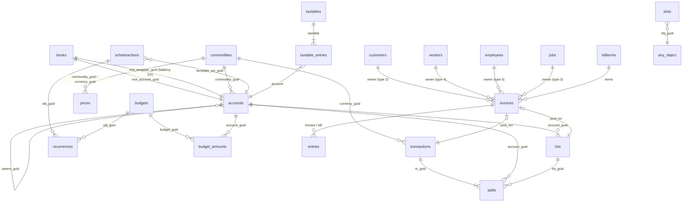

# Datový model GnuCash

Popis vychází z instalace `../GnuCashPortable` (PortableApps balíček **GnuCash 5.16**, `App/AppInfo/appinfo.ini`) a z místního zdrojového stromu `../gnucash` (verze 5.17, větev `stable`). Definice tabulek jsou převzaty přímo ze SQL backendu `gnucash/libgnucash/backend/sql/gnc-*-sql.cpp`, výčty z `gnucash/libgnucash/engine`. Mezi verzemi 5.16 a 5.17 se verze tabulek nemění.

Datum podkladů: 29. října 2026.

## 1. Co je v instalaci

| Cesta | Obsah |
| --- | --- |
| `App/Gnucash/bin/gnucash.exe` | Vlastní aplikace, spouští ji `GnuCashPortable.exe` |
| `App/Gnucash/lib/dbd/libdbdsqlite3.dll`, `libdbdmysql.dll`, `libdbdpgsql.dll` | Ovladače libdbi: úložiště SQLite, MySQL/MariaDB a PostgreSQL jsou k dispozici |
| `App/Gnucash/share/gnucash/accounts/cs/*.gnucash-xea` | 15 českých šablon účtů. Jsou to překlady šablon pro **osobní finance** („Šekový účet“, „Kreditní karta“, „Benzín“…). Směrnou účtovou osnovu neobsahují |
| `Data/settings/*.reg` | Uživatelské předvolby (GSettings) uložené PortableApps launcherem jako exporty registru |
| `Data/GNCDataHome/books/` | Stav oken a metadat jednotlivých knih (`.gcm`), nikoli účetní data. Nyní prázdné |
| `Data/GNCDataHome/translog/` | Prázdné. Transakční logy `.log` se běžně ukládají vedle souboru knihy |

V instalaci zatím není žádná účetní kniha. Uživatel ji ukládá do souboru, jehož umístění si zvolí (poslední cesta: `GnuCashPortable\Data`).

## 2. Úložiště

GnuCash drží celou knihu v paměti a do úložiště ji ukládá přes jeden ze dvou backendů. Logický model je v obou stejný.

| Backend | Formát | Ukládání | Vhodnost pro další zpracování |
| --- | --- | --- | --- |
| XML | `.gnucash`, XML komprimované gzipem, kořen `<gnc-v2>` | Celý soubor při každém uložení | Vhodné pro archivaci; dotazování vyžaduje parsování celého souboru |
| SQL (libdbi) | SQLite soubor (`sqlite3://`), MySQL nebo PostgreSQL | Po každé změně objektu (okamžitý commit) | **Doporučeno** pro napojení vlastních nástrojů (Python, SQL, Fabric) |

Převod mezi formáty: *Soubor → Uložit jako…* a volba datového formátu `sqlite3` nebo `xml`.

Další soubory vedle knihy: `*.LCK` (zámek u XML), `*.LNK`, `*.log` (transakční log pro obnovu), záložní kopie `*.YYYYMMDDhhmmss.gnucash`. U SQL backendu nahrazuje zámek tabulka `gnclock`.

## 3. Konvence ukládání v SQL

| Typ v modelu | SQLite | PostgreSQL | MySQL | Poznámka |
| --- | --- | --- | --- | --- |
| GUID a odkaz na objekt (`*_guid`, `parent`, `currency`…) | `text(32)` | `varchar(32)` | `varchar(32)` | 32 hex znaků bez pomlček. Cizí klíče **nejsou** deklarovány jako `FOREIGN KEY` |
| `INT` / `BOOLEAN` | `integer` | `integer` | `integer` | Boolean = 0/1 |
| `INT64` | `bigint` | `int8` | `bigint` | |
| `NUMERIC` | dva sloupce `X_num bigint`, `X_denom bigint` | `int8` | `bigint` | Racionální číslo: hodnota = `X_num / X_denom`. Pro CZK obvykle `denom = 100` |
| `TIME` (časový okamžik) | `text(19)` `YYYY-MM-DD HH:MM:SS` | `timestamp without time zone` | `DATETIME` | Vždy v **UTC**. Datum bez času ukládá GnuCash jako `10:59:00 UTC`, aby se v běžných časových pásmech zobrazilo stejné kalendářní datum |
| `GDATE` (kalendářní datum) | `text(8)` `YYYYMMDD` | `date` | `date` | Bez časové zóny |
| `STRING` | `text(n)` | `varchar(n)` | `varchar(n)` | UTF-8. Maximální délky viz tabulky; většinou 2048 |
| `ADDRESS` | 8 sloupců `X_name`, `X_addr1`–`X_addr4`, `X_phone`, `X_fax`, `X_email` | | | |
| `OWNERREF` | `X_type integer`, `X_guid text(32)` | | | Typ vlastníka viz výčet 6.6 |

Znaménko u `splits.value` a `splits.quantity`: **kladné = Má dáti (debet), záporné = Dal (kredit)**. Typ účtu ovlivňuje jen zobrazení znaménka v uživatelském rozhraní, ne uložená data.

## 4. Přehled entit a vazeb



Všechny objekty s GUID mohou mít rozšiřující atributy v tabulce `slots` (KVP), viz kapitola 7.

## 5. Tabulky

Sloupec „NN“ = `NOT NULL`, „PK“ = primární klíč. Verze tabulky je uložena v tabulce `versions`.

### 5.1 Systémové tabulky

**`versions`** – verze schématu

| Sloupec | Typ | Význam |
| --- | --- | --- |
| `table_name` | text(50) PK NN | Název tabulky, případně `Gnucash` a `Gnucash-Resave` (verze aplikace, která knihu zapsala) |
| `table_version` | integer NN | Verze schématu tabulky |

**`gnclock`** – zámek otevřené knihy: `Hostname varchar`, `PID int`.

### 5.2 Kniha a účetní osnova

**`books`** (v1)

| Sloupec | Typ | Význam |
| --- | --- | --- |
| `guid` | guid PK NN | Identifikátor knihy |
| `root_account_guid` | guid NN | Kořen stromu účtů (typ `ROOT`) |
| `root_template_guid` | guid NN | Kořen skrytého stromu šablonových účtů pro plánované transakce |

Nastavení knihy (název firmy, IČO, číselné řady, read-only hranice, funkce) jsou ve `slots` knihy, viz 7.1.

**`accounts`** (v1)

| Sloupec | Typ | NN | Význam |
| --- | --- | --- | --- |
| `guid` | guid | PK | |
| `name` | text(2048) | ano | Název účtu v rámci rodiče. Plná cesta se skládá ze jmen oddělených `:` |
| `account_type` | text(2048) | ano | Typ účtu, výčet 6.1 |
| `commodity_guid` | guid | | Měna nebo cenný papír účtu → `commodities` |
| `commodity_scu` | integer | ano | Nejmenší jednotka (Smallest Commodity Unit), např. 100 pro haléře |
| `non_std_scu` | integer | ano | 1 = SCU se liší od `fraction` komodity |
| `parent_guid` | guid | | Nadřazený účet; `NULL` jen u kořenových účtů |
| `code` | text(2048) | | **Číslo účtu** (volný text). Použitelné pro syntetické a analytické účty |
| `description` | text(2048) | | Popis |
| `hidden` | integer | | Skrytý účet |
| `placeholder` | integer | | Souhrnný účet, na který nelze přímo účtovat |

Poznámka k účtu, barva, daňové příznaky, mapování importu a další jsou ve `slots` (7.2).

**`commodities`** (v1) – měny a cenné papíry

| Sloupec | Typ | NN | Význam |
| --- | --- | --- | --- |
| `guid` | guid | PK, UNIQUE | |
| `namespace` | text(2048) | ano | `CURRENCY` pro měny ISO 4217, jinak burza nebo vlastní skupina |
| `mnemonic` | text(2048) | ano | Kód, např. `CZK`, `EUR` |
| `fullname` | text(2048) | | Plný název |
| `cusip` | text(2048) | | ISIN / CUSIP; u měn číselný kód ISO |
| `fraction` | integer | ano | Nejmenší dělitel (CZK = 100) |
| `quote_flag` | integer | ano | Stahovat kurzy online |
| `quote_source` | text(2048) | | Zdroj Finance::Quote |
| `quote_tz` | text(2048) | | Časové pásmo kurzu |

**`prices`** (v3) – ceník a kurzy

| Sloupec | Typ | NN | Význam |
| --- | --- | --- | --- |
| `guid` | guid | PK | |
| `commodity_guid` | guid | ano | Oceňovaná komodita |
| `currency_guid` | guid | ano | Měna ceny |
| `date` | time | ano | Okamžik platnosti |
| `source` | text(2048) | | Původ, např. `user:price-editor`, `user:xfer-dialog`, `Finance::Quote` |
| `type` | text(2048) | | `last`, `bid`, `ask`, `nav`, `transaction`, `unknown` |
| `value_num`, `value_denom` | bigint | ano | Cena 1 jednotky `commodity` v `currency` |

### 5.3 Transakce

**`transactions`** (v4) – hlavička účetního zápisu. Index `tx_post_date_index (post_date)`.

| Sloupec | Typ | NN | Význam |
| --- | --- | --- | --- |
| `guid` | guid | PK | |
| `currency_guid` | guid | ano | Měna transakce; v ní jsou všechny `splits.value` |
| `num` | text(2048) | ano | Číslo dokladu (může být prázdné). Při volbě knihy „Use Split Action Field for Number“ se číslo bere ze `splits.action` |
| `post_date` | time | | Datum účetního případu |
| `enter_date` | time | | Okamžik pořízení záznamu (systémový) |
| `description` | text(2048) | | Popis / protistrana |

Poznámky, storno, datum splatnosti a typ jsou ve `slots` (7.3).

**`splits`** (v5) – řádky zápisu (rozúčtování). Indexy `splits_tx_guid_index`, `splits_account_guid_index`.

| Sloupec | Typ | NN | Význam |
| --- | --- | --- | --- |
| `guid` | guid | PK | |
| `tx_guid` | guid | ano | → `transactions` |
| `account_guid` | guid | ano | → `accounts` |
| `memo` | text(2048) | ano | Text řádku |
| `action` | text(2048) | ano | Akce (`Faktura`, `Platba`…) nebo číslo dokladu, viz `num` |
| `reconcile_state` | text(1) | ano | Stav odsouhlasení, výčet 6.2 |
| `reconcile_date` | time | | Datum odsouhlasení |
| `value_num`, `value_denom` | bigint | ano | Částka v **měně transakce**. Součet `value` za transakci = 0 (podvojnost) |
| `quantity_num`, `quantity_denom` | bigint | ano | Množství v **komoditě účtu** (u cizoměnového účtu částka v cizí měně, u akcií počet kusů) |
| `lot_guid` | guid | | Přiřazení k lotu (párování faktur a plateb, nákupní dávky) |

Kurz řádku = `value / quantity`. Pokud se měna účtu shoduje s měnou transakce, platí `value = quantity`.

**`lots`** (v2) – párovací skupiny řádků

| Sloupec | Typ | NN | Význam |
| --- | --- | --- | --- |
| `guid` | guid | PK | |
| `account_guid` | guid | | Účet lotu, u faktur saldokontní účet (A/R, A/P) |
| `is_closed` | integer | ano | 1 = zůstatek lotu je nulový |

Název lotu a vazba na fakturu jsou ve `slots` (`title`, `gncInvoice/invoice-guid`).

### 5.4 Plánované transakce, rozpočty, opakování

**`schedxactions`** (v1)

| Sloupec | Typ | NN | Význam |
| --- | --- | --- | --- |
| `guid` | guid | PK | |
| `name` | text(2048) | | Název |
| `enabled` | integer | ano | Aktivní |
| `start_date`, `end_date`, `last_occur` | gdate | | Začátek, konec, poslední vytvoření |
| `num_occur`, `rem_occur` | integer | ano | Celkový a zbývající počet výskytů |
| `auto_create`, `auto_notify` | integer | ano | Automatické vytvoření, upozornění |
| `adv_creation`, `adv_notify` | integer | ano | Počet dní předstihu |
| `instance_count` | integer | ano | Počítadlo instancí |
| `template_act_guid` | guid | ano | Šablonový účet ve stromu `root_template_guid`; jeho splity tvoří vzor. Vzorce částek a cílové účty jsou ve slotech splitů (`sched-xaction/…`) |

**`recurrences`** (v2) – pravidla opakování pro SX a rozpočty

| Sloupec | Typ | NN | Význam |
| --- | --- | --- | --- |
| `id` | integer | PK, autoinc | |
| `obj_guid` | guid | ano | Vlastník pravidla (SX nebo rozpočet) |
| `recurrence_mult` | integer | ano | Násobek periody |
| `recurrence_period_type` | text(2048) | ano | `once`, `day`, `week`, `month`, `end of month`, `nth weekday`, `last weekday`, `year` |
| `recurrence_period_start` | gdate | ano | Počátek |
| `recurrence_weekend_adjust` | text(2048) | ano | `none`, `back`, `forward` |

**`budgets`** (v1): `guid` PK, `name` NN, `description`, `num_periods` NN.
**`budget_amounts`** (v1): `id` PK autoinc, `budget_guid` NN, `account_guid` NN, `period_num` NN, `amount_num/amount_denom` NN.

### 5.5 Obchodní modul (fakturace)

**`customers`** (v2) – odběratelé

| Sloupec | Typ | NN | Význam |
| --- | --- | --- | --- |
| `guid` | guid | PK | |
| `name` | text(2048) | ano | Název |
| `id` | text(2048) | ano | Interní číslo zákazníka (číselná řada knihy) |
| `notes` | text(2048) | ano | Poznámky |
| `active` | integer | ano | Aktivní |
| `discount_num/denom` | bigint | ano | Výchozí sleva v % |
| `credit_num/denom` | bigint | ano | Úvěrový limit |
| `currency` | guid | ano | Měna |
| `tax_override` | integer | ano | Použít vlastní daňovou tabulku |
| `addr_*` | adresa | | Fakturační adresa (8 sloupců) |
| `shipaddr_*` | adresa | | Dodací adresa |
| `terms` | guid | | → `billterms` |
| `tax_included` | integer | | Výčet 6.5 |
| `taxtable` | guid | | → `taxtables` |

**`vendors`** (v1) – dodavatelé: `guid`, `name` NN, `id` NN, `notes` NN, `currency` NN, `active` NN, `tax_override` NN, `addr_*`, `terms`, `tax_inc` (text: `YES`/`NO`/`USEGLOBAL`), `tax_table`.

**`employees`** (v2) – zaměstnanci (pro výdajové doklady, nikoli mzdy): `guid`, `username` NN, `id` NN, `language` NN, `acl` NN, `active` NN, `currency` NN, `ccard_guid` (účet platební karty), `workday_num/denom` NN, `rate_num/denom` NN, `addr_*`.

V modelu **nejsou samostatné sloupce pro IČO, DIČ ani bankovní účet partnera**.

**`jobs`** (v1) – zakázky: `guid`, `id` NN, `name` NN, `reference` NN, `active` NN, `owner_type`, `owner_guid`.

**`orders`** (v1): `guid`, `id` NN, `notes` NN, `reference` NN, `active` NN, `date_opened` NN, `date_closed` NN, `owner_type/owner_guid` NN.

**`invoices`** (v4) – faktury vydané, přijaté, výdajové doklady a dobropisy

| Sloupec | Typ | NN | Význam |
| --- | --- | --- | --- |
| `guid` | guid | PK | |
| `id` | text(2048) | ano | Číslo dokladu (číselné řady `gncInvoice`, `gncBill`, `gncExpVoucher`) |
| `date_opened` | time | | Datum vystavení / pořízení |
| `date_posted` | time | | Datum zaúčtování; `NULL` = nezaúčtovaná |
| `notes` | text(2048) | ano | Poznámky |
| `active` | integer | ano | |
| `currency` | guid | ano | Měna dokladu |
| `owner_type`, `owner_guid` | | | Partner: odběratel (2), zakázka (3), dodavatel (4), zaměstnanec (5) |
| `terms` | guid | | Platební podmínky |
| `billing_id` | text(2048) | | Číslo dokladu partnera / variabilní symbol |
| `post_txn` | guid | | Transakce vzniklá zaúčtováním |
| `post_lot` | guid | | Lot pro párování úhrad |
| `post_acc` | guid | | Saldokontní účet (A/R nebo A/P) |
| `billto_type`, `billto_guid` | | | Komu přefakturovat |
| `charge_amt_num/denom` | bigint | | Částka k přefakturaci (výdajové doklady) |

Druh dokladu se odvozuje z typu vlastníka a slotu `credit-note` (výčet 6.7). **Datum uskutečnění zdanitelného plnění (DUZP) ani datum splatnosti nejsou sloupci**; splatnost se při zaúčtování ukládá do slotu transakce `trans-date-due`.

**`entries`** (v4) – řádky faktur. Jeden řádek může být současně na faktuře vydané (`i_*`) i přijaté (`b_*`).

| Sloupec | Typ | Význam |
| --- | --- | --- |
| `guid` | guid PK | |
| `date` | time NN | Datum řádku |
| `date_entered` | time | Okamžik pořízení |
| `description`, `action`, `notes` | text(2048) | Popis, jednotka/akce, poznámka |
| `quantity_num/denom` | bigint | Množství |
| `i_acct` | guid | Výnosový účet (faktura vydaná) |
| `i_price_num/denom` | bigint | Jednotková cena |
| `i_discount_num/denom` | bigint | Sleva |
| `invoice` | guid | → `invoices` (vydaná) |
| `i_disc_type` | text | `VALUE` / `PERCENT` |
| `i_disc_how` | text | `PRETAX`, `SAMETIME`, `POSTTAX` |
| `i_taxable`, `i_taxincluded` | integer | Podléhá dani, cena včetně daně |
| `i_taxtable` | guid | → `taxtables` |
| `b_acct` | guid | Nákladový účet (faktura přijatá) |
| `b_price_num/denom` | bigint | Jednotková cena |
| `bill` | guid | → `invoices` (přijatá nebo výdajový doklad) |
| `b_taxable`, `b_taxincluded`, `b_taxtable` | | Jako u `i_*` |
| `b_paytype` | integer | 1 = hotově, 2 = kartou (výdajové doklady) |
| `billable` | integer | K přefakturaci |
| `billto_type`, `billto_guid` | | Komu přefakturovat |
| `order_guid` | guid | → `orders` |

**`taxtables`** (v2) – daňové tabulky (sazby DPH)

| Sloupec | Typ | NN | Význam |
| --- | --- | --- | --- |
| `guid` | guid | PK | |
| `name` | text(**50**) | ano | Název, např. `DPH 21 %` |
| `refcount` | bigint | ano | Počet použití |
| `invisible` | integer | ano | Skrytá (historická kopie) |
| `parent` | guid | | Rodičovská tabulka; při úpravě použité tabulky vzniká kopie |

**`taxtable_entries`** (v3): `id` PK autoinc, `taxtable` NN, `account` NN (účet daně), `amount_num/denom` NN (sazba nebo pevná částka), `type` NN (výčet 6.4). Jedna tabulka může mít více řádků → více daňových účtů.

**`billterms`** (v2) – platební podmínky: `guid`, `name` NN, `description` NN, `refcount` NN, `invisible` NN, `parent`, `type` NN (`GNC_TERM_TYPE_DAYS` / `GNC_TERM_TYPE_PROXIMO`), `duedays`, `discountdays`, `discount_num/denom`, `cutoff`.

### 5.6 Tabulka `slots` (KVP, rozšiřující atributy)

**`slots`** (v4), index `slots_guid_index (obj_guid)`

| Sloupec | Typ | NN | Význam |
| --- | --- | --- | --- |
| `id` | integer | PK, autoinc | |
| `obj_guid` | guid | ano | Vlastník: GUID libovolného objektu, nebo GUID vnořeného rámce |
| `name` | text(4096) | ano | Plná cesta klíče oddělená `/`, např. `options/Business/Company Name` |
| `slot_type` | integer | ano | Výčet 6.3 |
| `int64_val` | bigint | | |
| `string_val` | text(4096) | | |
| `double_val` | float8 | | |
| `timespec_val` | time | | |
| `guid_val` | guid | | Hodnota typu GUID; u typu `FRAME` a `GLIST` GUID vnořeného rámce |
| `numeric_val_num/denom` | bigint | | |
| `gdate_val` | gdate | | |

Vnořený rámec (`slot_type = 9`) má v `guid_val` nově vygenerovaný GUID. Jeho podřízené klíče mají tento GUID v `obj_guid`, ale v `name` mají stále plnou cestu.

## 6. Výčty

### 6.1 `accounts.account_type`

| Hodnota | Kód | Význam |
| --- | --- | --- |
| `BANK` | 0 | Bankovní účet |
| `CASH` | 1 | Pokladna |
| `ASSET` | 2 | Aktivum |
| `CREDIT` | 3 | Kreditní karta |
| `LIABILITY` | 4 | Závazek |
| `STOCK` | 5 | Akcie |
| `MUTUAL` | 6 | Podílový fond |
| `CURRENCY` | 7 | Měnový účet (zastaralé) |
| `INCOME` | 8 | Výnos |
| `EXPENSE` | 9 | Náklad |
| `EQUITY` | 10 | Vlastní kapitál |
| `RECEIVABLE` | 11 | Pohledávky – saldokonto odběratelů (A/R) |
| `PAYABLE` | 12 | Závazky – saldokonto dodavatelů (A/P) |
| `ROOT` | 13 | Skrytý kořen |
| `TRADING` | 14 | Obchodní účet pro vícemenové transakce |

Výkaz zisku a ztráty GnuCash počítá z typů `INCOME` a `EXPENSE`. Uzávěrka knihy („Close Book“) převádí jejich zůstatky na zvolený účet `EQUITY`.

### 6.2 `splits.reconcile_state`

`n` = neodsouhlaseno, `c` = vyčištěno, `y` = odsouhlaseno, `f` = zmrazeno (uzavřené období), `v` = stornováno.

### 6.3 `slots.slot_type`

1 `INT64`, 2 `DOUBLE`, 3 `NUMERIC`, 4 `STRING`, 5 `GUID`, 6 `TIME64`, 7 nepoužívá se, 8 `GLIST`, 9 `FRAME`, 10 `GDATE`.

### 6.4 `taxtable_entries.type`

1 = pevná částka (`VALUE`), 2 = procento (`PERCENT`).

### 6.5 `customers.tax_included`

1 = ceny včetně daně, 2 = bez daně, 3 = podle globálního nastavení.

### 6.6 `*_type` u odkazu na vlastníka

0 žádný, 1 nedefinovaný, 2 odběratel, 3 zakázka, 4 dodavatel, 5 zaměstnanec.

### 6.7 Druh dokladu (odvozený)

| Vlastník | Slot `credit-note` = 0 | Slot `credit-note` = 1 |
| --- | --- | --- |
| Odběratel / zakázka odběratele | Faktura vydaná | Dobropis vydaný |
| Dodavatel / zakázka dodavatele | Faktura přijatá | Dobropis přijatý |
| Zaměstnanec | Výdajový doklad | Dobropis zaměstnance |

## 7. Významné klíče ve `slots`

### 7.1 Kniha (`obj_guid = books.guid`)

| Klíč | Typ | Význam |
| --- | --- | --- |
| `options/Business/Company Name` | string | Název účetní jednotky |
| `options/Business/Company Address` | string | Adresa |
| `options/Business/Company ID` | string | IČO nebo DIČ (jediné pole) |
| `options/Business/Company Phone Number`, `…Fax Number`, `…Email Address`, `…Website URL`, `…Contact Person` | string | Kontakty |
| `options/Business/Default Customer TaxTable`, `Default Vendor TaxTable` | guid | Výchozí daňové tabulky |
| `options/Accounts/Use Trading Accounts` | string `t` | Obchodní účty pro vícemenové transakce |
| `options/Accounts/Day Threshold for Read-Only Transactions (red line)` | double | Transakce starší než N dní jsou jen pro čtení |
| `options/Accounts/Use Split Action Field for Number` | string `t` | Číslo dokladu v `splits.action` |
| `counters/gncInvoice`, `counters/gncBill`, `counters/gncCustomer`, `counters/gncVendor`, `counters/gncJob`, `counters/gncExpVoucher` | int64 | Poslední použité číslo řady |
| `counter_formats/<totéž>` | string | Formát čísla ve stylu printf, např. `FV%06li` |
| `features/<název>` | string | Funkce, které kniha vyžaduje; starší verze GnuCash ji neotevřou |

### 7.2 Účet

`notes`, `color`, `filter`, `sort-order`, `sort-reversed`, `placeholder`, `hidden`, `tax-related` (int64), `tax-US/code`, `tax-US/payer-name-source`, `tax-US/copy-number`, `equity-type` = `opening-balance`, `reconcile-info/…`, `import-map/…`, `import-map-bayes/…`, `online_id`, `last-num`, `lot-mgmt/…`, `ofx/associated-income-account`.

Daňové kódy `tax-US` jsou navázané na americké formuláře (TXF). Pro českou legislativu je nelze použít.

### 7.3 Transakce

| Klíč | Typ | Význam |
| --- | --- | --- |
| `notes` | string | Poznámky |
| `trans-txn-type` | string | `I` = faktura, `P` = platba, `L` = párování lotů |
| `trans-date-due` | time | Datum splatnosti (u faktur) |
| `trans-read-only` | string | Důvod uzamčení, např. „Vytvořeno fakturou…“ |
| `void-reason`, `void-time`, `void-former-notes` | string | Údaje o stornu |
| `reversed-by` | guid | Opravná (protisměrná) transakce |
| `from-sched-xaction` | guid | Vznik z plánované transakce |
| `gncInvoice/invoice-guid` | guid | Faktura, kterou transakce zaúčtovala |
| `assoc_uri` | string | Odkaz na naskenovaný doklad (URI); v UI „Document Link“ |

### 7.4 Řádek transakce (split)

`sched-xaction/account`, `sched-xaction/credit-formula`, `sched-xaction/debit-formula`, `sched-xaction/credit-numeric`, `sched-xaction/debit-numeric`, `sched-xaction/shares` (jen šablony SX), `split-type` (`normal`, `stock-split`), `online_id`, `lot-split`, `gains-split`, `gains-source`, `void-former-amount`, `void-former-value`.

### 7.5 Faktura a lot

Faktura: `credit-note` (int64), `assoc_uri` (odkaz na doklad). Lot: `title`, `notes`, `gncInvoice/invoice-guid`, `gncOwner/owner-type`, `gncOwner/owner-guid`.

## 8. Vlastnosti modelu důležité pro účetnictví

1. **Podvojnost:** pro každou transakci platí `SUM(value) = 0`. Zůstatek účtu = `SUM(quantity)` jeho splitů.
2. **Jediná dimenze analytiky je strom účtů.** Středisko, zakázka nebo činnost se musí řešit podúčty nebo textem v `memo`. Zakázky (`jobs`) existují jen v obchodním modulu.
3. **Bez auditní stopy.** Úpravy přepisují řádky (SQL `UPDATE`/`DELETE`). Smazanou transakci nelze dohledat. Translog `.log` vzniká jen u XML backendu a slouží k obnově, nikoli jako auditní záznam.
4. **Bez uživatelů a oprávnění.** `enter_date` je jediný údaj o pořízení; kdo záznam pořídil, se neukládá.
5. **Bez účetních období.** Uzavření se řeší jen hranicí „read-only“ (počet dní), stavem `f` a uzávěrkovými transakcemi „Close Book“.
6. **Datum účetního případu je časový okamžik.** Pro výběry podle dne převádějte `post_date` do lokálního data nebo používejte konvenci `10:59:00 UTC`.
7. **Částky jsou racionální čísla.** Při čtení vždy dělte `num/denom`, nepoužívejte `float`.
8. **Cizí klíče nejsou vynucené databází.** Integritu drží jen aplikace; externí zápisy do databáze mohou knihu poškodit.

## 9. Příklady dotazů (SQLite)

```sql
-- Účetní deník: chronologicky všechny řádky v CZK
SELECT date(t.post_date)                         AS datum,
       t.num                                      AS doklad,
       t.description                              AS popis,
       a.code                                     AS ucet,
       a.name                                     AS nazev_uctu,
       CASE WHEN s.value_num > 0 THEN  1.0 * s.value_num / s.value_denom END AS md,
       CASE WHEN s.value_num < 0 THEN -1.0 * s.value_num / s.value_denom END AS dal,
       s.memo
FROM transactions t
JOIN splits   s ON s.tx_guid = t.guid
JOIN accounts a ON a.guid = s.account_guid
ORDER BY t.post_date, t.num, t.guid;

-- Obratová předvaha k datu
SELECT a.code, a.name,
       SUM(CASE WHEN s.quantity_num > 0 THEN 1.0 * s.quantity_num / s.quantity_denom ELSE 0 END) AS obrat_md,
       SUM(CASE WHEN s.quantity_num < 0 THEN -1.0 * s.quantity_num / s.quantity_denom ELSE 0 END) AS obrat_dal,
       SUM(1.0 * s.quantity_num / s.quantity_denom)                                               AS zustatek
FROM accounts a
JOIN splits s       ON s.account_guid = a.guid
JOIN transactions t ON t.guid = s.tx_guid
WHERE t.post_date < '2027-01-01'
GROUP BY a.guid
ORDER BY a.code;

-- Rozbalení slotů jednoho objektu
SELECT name, slot_type, string_val, int64_val, guid_val, timespec_val,
       1.0 * numeric_val_num / NULLIF(numeric_val_denom, 0) AS numeric_val
FROM slots
WHERE obj_guid = :guid;
```

Pro výpočty v Pythonu používejte `fractions.Fraction(num, denom)` nebo `decimal.Decimal(num) / denom`. Databázi otevírejte jen pro čtení, pokud je kniha současně otevřená v GnuCash.

## 10. Zdroje v místním stromu

- Definice tabulek: [gnucash/libgnucash/backend/sql](../gnucash/libgnucash/backend/sql)
- Mapování typů pro SQLite, MySQL a PostgreSQL: [gnc-dbiproviderimpl.hpp](../gnucash/libgnucash/backend/dbi/gnc-dbiproviderimpl.hpp)
- XML formát: [gnucash/libgnucash/backend/xml](../gnucash/libgnucash/backend/xml)
- Typy účtů: [Account.h](../gnucash/libgnucash/engine/Account.h)
- Typy KVP: [kvp-value.hpp](../gnucash/libgnucash/engine/kvp-value.hpp)
- Nastavení knihy: [qofbookslots.h](../gnucash/libgnucash/engine/qofbookslots.h)
- Klíče transakcí: [Transaction.cpp](../gnucash/libgnucash/engine/Transaction.cpp)
